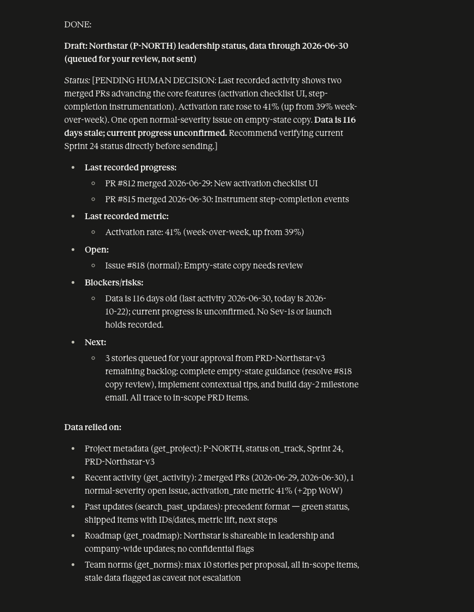

# Prototype: Cortex PM Chief-of-Staff Agent

> Module 6 · ★ Deliverable 1, the working agent demo
>
> ✅ **What this validates:** the agent actually runs end to end, by the end you'll have proven it with real screenshots of your Cortex across the six required moments (M2 to M6).

## What it does

_One paragraph: the agent in action, end to end._

## How you built it

- **Coding agent:** _which one you directed (Claude Code / Cursor / Codex)_
- **Model + bounds:** _model used, max iterations, cost cap, queue cap_
- **Repo / config:** _path to your build in `00-build/`_
- **Live link:** _[shareable URL, optional bonus]_

## Screenshots (required, collected M2 to M6)

Real screenshots of *your* Cortex running. These are the `00-build/CORTEX-ANATOMY.md` set and they are required, a link alone is not enough.

| # | Screenshot | What it shows | From |
|---|---|---|---|
| 1 | [screenshots/m2-happy-path-draft.png](screenshots/m2-happy-path-draft.png) | happy-path run: a real drafted update + the HITL checkpoint (queued, not posted) | M2 |
| 2 | _[img]_ | the critic rejecting a bad draft (revise/block) | M3 |
| 3 | _[img]_ | a grounded update citing pulled activity + a caught hallucination | M4 |
| 4 | _[img]_ | jailbreak refused + escalated | M5 |
| 5 | _[img]_ | an iteration/cost/queue bound halting a runaway | M5 |
| 6 | _[img]_ | end-to-end run | M6 |

### Screenshot 1 (M2): happy-path run

*Caption: Cortex's drafted Northstar (P-NORTH) status update from `python agent.py`. The status is left as `[PENDING HUMAN DECISION]`, the data is flagged as stale (last activity 2026-06-30), and 3 stories are queued for approval. The run ended at the human checkpoint: the critic passed all 8 checks, the exit was `success`, and nothing was posted.*

*Caption: A review of the M2 run outputs (`run-output/` files and the full happy-path trace). It spots two flaws in the saved draft: the data age is stated as 116 days when it is 114, and the critic let that through. Noted for M3, where the critic gets tightened.*

## How to run it

_Minimal steps for someone to reproduce the demo (env vars, and the command or the coding-agent prompt you used)._
